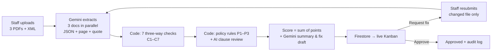
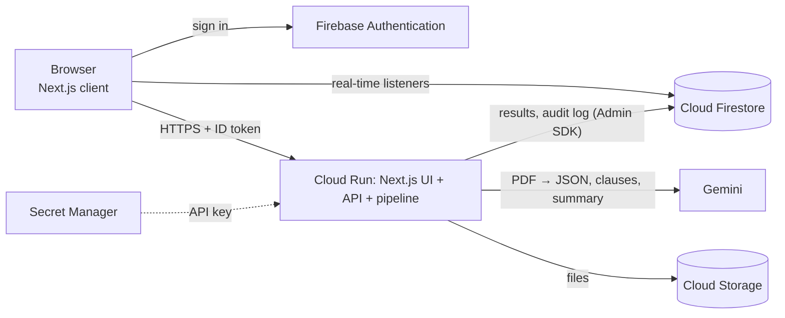

# OmniOps AI

**AI 3-way match & approval assistant for accounts-payable teams.**
OmniOps AI checks the **Contract ↔ Acceptance record ↔ VAT invoice** (plus the Vietnamese e-invoice XML) of every purchase against company policy, explains every mismatch with page-level citations, and closes the *request fix → re-check → approve* loop in real time — with an append-only audit trail.

> AI Builder Cup · Track: **Future of Work & Enterprise Productivity** · Built on **Gemini, Cloud Run, Firebase Authentication and Cloud Firestore**.

| | |
|---|---|
| 🚀 **Live prototype** | https://omniops-408588480127.us-central1.run.app/ |
| 🎬 **Demo video** | https://youtu.be/25_88LAAfdM |
| 📖 **Project knowledge** | [docs/PROJECT_DOCUMENTATION.md](docs/PROJECT_DOCUMENTATION.md) |

## How to try (no account needed)

1. Open the live prototype → click **"Try as Staff"**.
2. Pick a sample package, e.g. **"Unit-price gap + wrong VAT"** → watch the 4 analysis steps → result **60/100** with 3 findings; click a quote to open the PDF at the cited page.
3. Top bar → **"Switch to Manager"** → the package is on the live Kanban → open it → **"Request fix"** (the text is drafted by AI) → send.
4. Switch back to Staff → **"Demo: submit the corrected sample invoice"** → version 2 scores **0/100**.
5. Switch to Manager → **"Approve"** → open the **"Audit log"**.

> Tip: open a second, incognito window with the other role to watch both screens update in real time. The interface is in English; the sample documents themselves are Vietnamese purchase documents, which is exactly the input this product is built to read.

## The problem

Before paying a supplier, an accountant must confirm that what was **contracted**, what was **delivered** and what is **invoiced** agree. Done by hand this takes days across departments, and errors slip through: a slightly higher unit price, miscalculated VAT, an invoice from another tax ID, or a contract with an unusually harsh penalty clause.

## What it does

| Feature | Details |
|---|---|
| Package upload | 3 PDFs (contract, acceptance record, invoice) + optional e-invoice XML; type, size and page checks |
| Gemini extraction | The three PDFs are read **in parallel** into structured JSON, each key value with **page number + verbatim quote** |
| 7 three-way checks (code) | Seller tax ID · total vs contract (with tolerance) · VAT arithmetic · invoiced vs accepted quantity · unit price · invoice date vs acceptance date · e-invoice XML vs PDF |
| Policy rules (code) | Max late-payment penalty, max advance payment, max payment term, total tolerance — editable by managers |
| AI clause review | Gemini flags contract clauses unfavourable to the buyer (labelled "AI", capped at 15 points) |
| Explainable risk score | 0–100 = sum of finding points; "Why 60 points?" lists every contribution |
| Real-time Kanban | Pending · Needs fix · Done; Approve / Request fix (AI-drafted text) / Reject |
| Fix loop | Staff resubmits only the corrected file; only changed documents are re-read by Gemini; all checks re-run |
| Audit log | Append-only; stores actor, action, version, model, prompt hash and result hash |
| Judge / demo mode | One-click anonymous sign-in as Staff or Manager, sample packages, role switch |

## How it works



| Check | Fires when | Points |
|---|---|---|
| C1 Seller tax ID | invoice ≠ contract | 35 |
| C2 Total | invoice total differs from contract by more than the tolerance (default 0.5 %) | 20 |
| C3 VAT | subtotal × rate ≠ VAT amount (±1,000 đ), or subtotal + VAT ≠ total | 20 |
| C4 Quantity | invoiced quantity > accepted quantity, or item not accepted | 20 |
| C5 Unit price | invoice unit price ≠ contract unit price | 20 |
| C6 Date order | invoice dated before acceptance | 10 |
| C7 XML vs PDF | e-invoice XML total or tax ID ≠ PDF | 35 |
| P1 / P2 / P3 | penalty > 0.1 %/day · advance > 30 % · payment term > 45 days | 20 / 10 / 5 |
| AI | unfavourable clause flagged by Gemini | 5 each, max 15 |

Score levels: < 20 low · < 50 medium · < 80 high · ≥ 80 critical. The numeric checks are deterministic code, so the same documents always produce the same score; Gemini only reads documents, flags clauses and writes text.

## Architecture & Google Cloud services



| Service | How OmniOps AI uses it |
|---|---|
| **Gemini** (Gemini API, `@google/genai`) | Parallel PDF extraction with JSON schema + evidence; unfavourable-clause review; summary and fix-request draft |
| **Cloud Run** | Hosts the whole Next.js app — UI, API routes and the analysis pipeline — as one container (source deploy via Cloud Build) |
| **Firebase Authentication** | Google sign-in + anonymous demo mode for Staff / Manager |
| **Cloud Firestore** | Packages, findings, approvals, policy rules, append-only audit log, extraction cache; real-time listeners drive both screens |
| **Cloud Storage** | Uploaded contract / acceptance / invoice files |
| **Secret Manager** | Gemini API key |

Gemini runs through the Gemini API today and can be switched to **Vertex AI** with one environment variable (`GOOGLE_GENAI_USE_VERTEXAI=true`).

## Benchmark

20 synthetic packages with labelled errors (8 clean, 8 with one error, 4 with two errors), 3 runs each —
60 analyses, 180 Gemini calls, 0 failures. Model `gemini-3.8-flash`, run on 17 Oct 2026.
Full results: [benchmark/results.md](benchmark/results.md) · raw data: [benchmark/results.csv](benchmark/results.csv).

| Metric | Result |
|---|---|
| Injected errors detected | **66 / 66 (100%)** |
| False positives on clean packages | **0** across 24 analyses |
| Hallucinated AI findings on clean packages | **0.00** per package |
| Median / p95 time per package | **10.2 s / 11.8 s** |
| Max score change across runs | **0 points** |

Every check reached 100% detection individually (C1–C7, P1, P2). The run-to-run spread of 0 points comes from the
split design: Gemini only extracts facts, while the comparisons and the score are plain deterministic code.

> **Read these numbers for what they are.** The documents are synthetic and generated by
> [scripts/gen_packages.py](scripts/gen_packages.py), the same script that defines the ground truth — so this
> measures pipeline correctness, not robustness to real-world or scanned documents. The full list of limitations is
> in [benchmark/results.md](benchmark/results.md).

## Repository structure

```text
src/
├── app/                 # pages: /, /staff, /staff/new, /packages/[id], /manager, /manager/policies, /manager/audit
│   └── api/             # packages, packages/from-sample, packages/[id]/{decision,resubmit,retry}, files/[id]/[docType], policies, health
├── components/          # Kanban, findings list, PDF viewer, progress, decisions, resubmit form, …
├── lib/
│   ├── pipeline/        # schemas, prompts, extract, invoiceXml, threeWayMatch, policy, score, summarize, run
│   ├── packages.ts      # create / resubmit / retry, validation, rate limit
│   └── firebase*.ts, storage.ts, gemini.ts, auth-*.ts, hooks.ts, audit.ts
└── types/domain.ts
scripts/                 # gen_packages.py, test-match.ts, smoke-local.ts, try-pipeline.ts, benchmark.ts, seed.ts, deploy.ps1, dev-local.mjs
public/samples/          # synthetic demo packages + ground-truth manifest
benchmark/               # 20 labelled packages (+ results)
firestore.rules          # security rules
Dockerfile               # Next.js standalone image for Cloud Run
```

See [docs/PROJECT_DOCUMENTATION.md](docs/PROJECT_DOCUMENTATION.md) for how Firebase, Firestore, Cloud Run and Gemini are used, the pipeline, the AI-vs-code split and the benchmark.

## Run locally (no Google Cloud account needed)

Requirements: Node.js ≥ 20.9, Java ≥ 21 (Firebase Emulator), Python 3 + `pip install reportlab` (only to regenerate samples).

```bash
npm ci
```

```bash
npm run emulators
```

In a second terminal:

```bash
npm run seed:local
```

```bash
npm run dev:local
```

Open http://localhost:3000. This mode uses the Firebase Emulator, stores files in `.local-storage/`, and **mocks Gemini** (`GEMINI_MOCK=true` in [.env.emulator](.env.emulator)): extraction returns the ground truth of the synthetic samples and a yellow banner is shown. Use it to explore the UI and flows; use a real Gemini key for anything else.

## Setup on Google Cloud

1. **Project & APIs** — create a project with billing (set a budget alert), then:
   `gcloud services enable run.googleapis.com cloudbuild.googleapis.com artifactregistry.googleapis.com secretmanager.googleapis.com firestore.googleapis.com storage.googleapis.com compute.googleapis.com`
2. **Firebase** — add Firebase to the project; Authentication → enable **Google** and **Anonymous**; create Firestore (Native, `us-central1`) and publish [firestore.rules](firestore.rules); register a **web app** and copy its config.
3. **Storage** — `gcloud storage buckets create gs://<PROJECT_ID>-docs --location=us-central1 --uniform-bucket-level-access`
4. **Gemini** — create an API key in Google AI Studio and confirm the model ID (default `gemini-3.8-flash`, set with `GEMINI_MODEL`).
5. **Secret & IAM** — store the key: `gcloud secrets create gemini-api-key` + `gcloud secrets versions add gemini-api-key --data-file=<file>`; grant the Cloud Run service account `<PROJECT_NUMBER>-compute@developer.gserviceaccount.com` the roles `secretmanager.secretAccessor`, `datastore.user`, `run.builder`, and `storage.objectAdmin` on the bucket.
6. **Configuration** — fill the `TODO` values (`git grep -n TODO`): the web config in [src/lib/firebase.ts](src/lib/firebase.ts); copy [.env.example](.env.example) to `.env.local` and fill it; put the project ID in `.firebaserc`.
7. **Seed & run locally against the project** — `gcloud auth application-default login`, then `npm run seed` and `npm run dev`.
8. **Deploy** — `powershell -ExecutionPolicy Bypass -File .\scripts\deploy.ps1 -ProjectId <PROJECT_ID>` (options: `-Model`, `-Bucket`, `-Tag`, `-Vertex`).
9. **After the first deploy** — add the `*.run.app` domain to Firebase Authentication → Settings → **Authorized domains**; check `/api/health` returns `"mock": false`; run each sample package once to warm the extraction cache.

## Testing

| Command | What it checks |
|---|---|
| `npm run test:match` | 20 cases of the three-way-match / policy / scoring logic (no network) |
| `npm run smoke:local` | 17 end-to-end API checks on the emulator: auth & roles, create, findings, file access, decisions, resubmit, approve, audit log |
| `npm run try:pipeline -- public/samples/s2-errors [--json]` | Real Gemini on one package (needs `GEMINI_API_KEY`) |
| `npm run benchmark -- --runs 3` | Accuracy and latency on the 20 labelled packages |
| `npm run typecheck` · `npm run lint` · `npm run build` | Types, lint, production build |

## Security

- Every API call verifies the Firebase ID token and the user's role on the server.
- Browsers can only read their own packages (managers: all) and can never write results, decisions, policies or the audit log — enforced by [Firestore Rules](firestore.rules); the server writes with the Admin SDK.
- The only secret (Gemini API key) lives in Secret Manager / `.env.local`, and Gemini is called only from the server.
- Limits: 4 MB per file, 15 PDF pages, 10 analyses per user per hour, max 2 Cloud Run instances.

## Limitations & roadmap

- Demo data is synthetic; scanned or photographed documents are not tested yet (next: Document AI for scans and line-level highlights).
- Items are matched across documents by item code.
- Demo mode lets a user choose their role; production would assign roles by admin (custom claims).
- Next: purchase orders and delivery notes, multi-level approval, ERP/accounting integrations, Vertex AI for enterprise data controls, e-signature.

## Team

**NEXT GEN** — Truc Tran, Phuong Tran.
