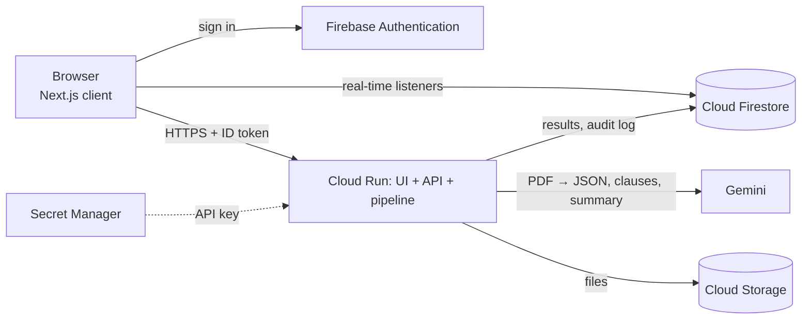
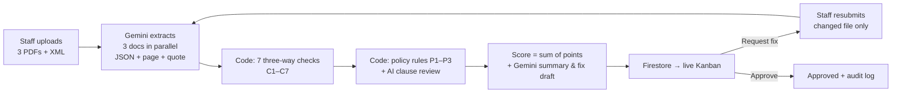

# OmniOps AI — Project knowledge

| | |
|---|---|
| **Track** | Future of Work & Enterprise Productivity |
| **Live prototype** | https://omniops-408588480127.us-central1.run.app/ |
| **Demo video** | _TODO – video link_ |
| **Source** | This repository · setup and deployment in the [README](../README.md) |
| **Team** | NEXT GEN — Truc Tran, Phuong Tran |

## Contents

1. [What we built](#1-what-we-built)
2. [How we use Firebase, Firestore, Cloud Run and Gemini](#2-how-we-use-firebase-firestore-cloud-run-and-gemini)
3. [Architecture](#3-architecture)
4. [The analysis pipeline](#4-the-analysis-pipeline)
5. [What is AI and what is code](#5-what-is-ai-and-what-is-code)
6. [Try it](#6-try-it)
7. [Benchmark](#7-benchmark)
8. [Security](#8-security)
9. [Code map and tests](#9-code-map-and-tests)
10. [Limitations and roadmap](#10-limitations-and-roadmap)
11. [FAQ](#11-faq)

---

## 1. What we built

**OmniOps AI is an AI 3-way match and approval assistant for accounts-payable teams.**

Before a company pays a supplier, an accountant must confirm that three documents agree:

| Document | Says |
|---|---|
| **Contract** | what was agreed: items, unit prices, VAT, payment terms, penalties |
| **Acceptance record** | what was actually delivered and accepted |
| **VAT invoice** (+ Vietnamese e-invoice XML) | what the supplier is charging |

Done by hand this is slow, and the costly errors are subtle: a unit price slightly above the contract, a miscalculated
VAT, more units invoiced than accepted, an invoice from a different tax ID, an invoice dated before acceptance, or a
contract with an unusually harsh penalty clause.

**OmniOps AI:**

1. **Gemini reads** the three PDFs in parallel into structured data, with a **page number and verbatim quote** for every key value.
2. **Deterministic code** runs 7 cross-document checks and the company's editable policy rules, and cross-checks the invoice PDF against its **e-invoice XML**.
3. Every mismatch becomes a **finding with evidence**; the **risk score (0–100)** is the sum of the findings' points, so every point is explained.
4. A manager sees the package on a **real-time Kanban**, requests a fix (text drafted by Gemini), the staff member resubmits only the corrected file, the system re-checks automatically, and the manager approves.
5. Every action is written to an **append-only audit log**.

**Results** on 20 labelled packages × 3 runs: 66/66 injected errors caught, 0 false positives, 0-point score
variation between runs, ~10 s per package (synthetic documents — see [§7](#7-benchmark)).

---

## 2. How we use Firebase, Firestore, Cloud Run and Gemini

### Gemini — reading documents and writing text

Called only from the server through the official `@google/genai` SDK; model set by `GEMINI_MODEL` (default `gemini-3.8-flash`).

| Use | How |
|---|---|
| **Document extraction** | Each PDF (contract, acceptance record, invoice) is sent as bytes with a prompt and a strict **JSON schema** (`responseJsonSchema`, `temperature: 0`). The three calls run **in parallel**. Gemini returns typed fields plus `{ field, page, quote }` evidence for each key value |
| **Contract clause review** | Gemini lists clauses unfavourable to the buyer; each becomes an "AI" finding (5 points, max 15 in total) |
| **Summary and fix-request draft** | Gemini writes a 2–3 sentence summary and the message the manager sends back to staff, from the findings only — it is instructed not to add findings or change numbers |
| **Efficiency** | Extractions are cached in Firestore by file SHA-256; on resubmission only the changed document is sent again. ~4 Gemini calls per package |
| **Vertex AI ready** | `GOOGLE_GENAI_USE_VERTEXAI=true` switches the same code to Gemini on Vertex AI |

Code: [gemini.ts](../src/lib/gemini.ts) · [extract.ts](../src/lib/pipeline/extract.ts) · [prompts.ts](../src/lib/pipeline/prompts.ts) · [schemas.ts](../src/lib/pipeline/schemas.ts) · [summarize.ts](../src/lib/pipeline/summarize.ts)

### Cloud Run — hosting the whole application

| Use | How |
|---|---|
| **One service** | The Next.js app (UI, API routes and the analysis pipeline) is built as a standalone container and deployed from source via Cloud Build |
| **Request-scoped pipeline** | Each API request awaits the full analysis before responding, so it runs while Cloud Run allocates CPU |
| **Configuration** | 1 vCPU, 1 GiB, 300 s timeout, scales 0 → 2 instances; the Gemini API key is injected from **Secret Manager** |
| **Storage** | Uploaded files are stored in **Cloud Storage**, versioned per resubmission (`packages/{id}/v{n}/…`) |

Code: [Dockerfile](../Dockerfile) · [deploy.ps1](../scripts/deploy.ps1) · [storage.ts](../src/lib/storage.ts)

### Firebase Authentication — sign-in and roles

| Use | How |
|---|---|
| **Sign-in** | Google sign-in, plus **anonymous sign-in** for one-click demo access as Staff or Manager |
| **API protection** | The browser sends its Firebase ID token with every request; the server verifies it with the Admin SDK and loads the user's role before doing anything else |

Code: [auth-client.ts](../src/lib/auth-client.ts) · [auth-server.ts](../src/lib/auth-server.ts) · [firebase.ts](../src/lib/firebase.ts)

### Cloud Firestore — data, real time and audit trail

| Collection | Contents |
|---|---|
| `packages/{id}` | Package status, live progress, latest score and breakdown, summary, extracted data, version history |
| `packages/{id}/findings` | One finding per issue per version, with evidence |
| `packages/{id}/approvals` | Decisions and resubmissions |
| `policy_rules` | Policy thresholds editable by managers |
| `audit_log` | Append-only log of every action, with model ID, prompt hash and result hash |
| `extraction_cache` | Gemini extraction results keyed by file SHA-256 + document type + model |
| `users/{uid}` | Role and usage counter |

| Use | How |
|---|---|
| **Real time** | Browsers subscribe with `onSnapshot`: the progress steps, the result, the Kanban and the other role's screen update instantly without polling or custom WebSocket code |
| **Server-only writes** | The server writes results in one batch through the Admin SDK; manager decisions run in a **transaction** so a package can be decided only once |
| **Security Rules** | Browsers may read only their own packages (managers: all) and can never write results, decisions, policies or the audit log |

Code: [hooks.ts](../src/lib/hooks.ts) · [run.ts](../src/lib/pipeline/run.ts) · [audit.ts](../src/lib/audit.ts) · [firestore.rules](../firestore.rules)

---

## 3. Architecture



| Design decision | Reason |
|---|---|
| One Cloud Run service for UI + API + pipeline | One deployment, one URL, no cross-origin setup |
| Browsers only read Firestore; all writes go through the API | Users cannot fake a score or approve their own package |
| Real-time through Firestore listeners | The server writes once; every open screen updates |
| Checks in code, AI for reading and wording | Reproducible, explainable scores |
| Extraction cache by file hash | Saves Gemini calls; stable, fast re-checks |

### Package life cycle

```
           ┌──────────── retry ────────────┐
           ▼                               │
  (upload) analyzing ──ok──► pending_review ──approve──► approved
               │                 │  │
               └──fail──► error  │  └──reject──► rejected
                                 │
                            request_fix
                                 ▼
                             needs_fix ──resubmit──► analyzing (version + 1)
```

---

## 4. The analysis pipeline



| ID | Check | Fires when | Points |
|---|---|---|---|
| C1 | Seller tax ID | invoice seller tax ID ≠ contract | 35 |
| C2 | Total | invoice total differs from contract by more than the tolerance (default 0.5 %) | 20 |
| C3 | VAT arithmetic | subtotal × rate ≠ VAT (±1,000 đ), or subtotal + VAT ≠ total | 20 |
| C4 | Quantity | invoiced quantity > accepted quantity, or item not accepted | 20 |
| C5 | Unit price | invoice unit price ≠ contract unit price | 20 |
| C6 | Date order | invoice dated before acceptance | 10 |
| C7 | XML vs PDF | e-invoice XML total or tax ID ≠ PDF invoice | 35 |
| P1 / P2 / P3 | Policy | penalty > 0.1 %/day · advance > 30 % · payment term > 45 days (editable) | 20 / 10 / 5 |
| AI | Clause review | contract clause unfavourable to the buyer, flagged by Gemini | 5 each, max 15 |

- **Score** = min(100, sum of points). Levels: < 20 low · < 50 medium · < 80 high · ≥ 80 critical.
- **Suggested action:** any critical finding → Reject if score ≥ 80, otherwise Request fix; any high/medium → Request fix; none → Approve. The manager makes the final decision.
- Line items are matched across documents by normalised item code (`sv01` = `SV-01`).
- If a Gemini call fails, it is retried once; if it still fails the package shows **Try again**. If the summary call fails, a template text is used.

---

## 5. What is AI and what is code

| Step | Done by |
|---|---|
| Read PDFs into structured fields + page + quote | **Gemini** |
| Read the e-invoice XML | Code |
| Compare documents (C1–C7), apply policies (P1–P3) | **Code** — pure functions, no network |
| Flag unfavourable contract clauses | **Gemini** — labelled "AI", capped at 15 points |
| Compute the score and suggested action | Code |
| Write the summary and fix-request draft | **Gemini** |
| Approve / reject / request fix | **Human manager** |

Safeguards:

- **Evidence on every value** — a misread number is visible through the quote and page Gemini used.
- **Independent source** — the e-invoice XML is parsed by code and checked against the PDF (C7).
- **Bounded AI influence** — AI-judged findings add at most 15 points and cannot flip the recommendation on their own.
- **Traceability** — each analysis is logged with the model ID, a SHA-256 hash of the prompts and a hash of the findings.

---

## 6. Try it

No account is needed: **Try as Staff** / **Try as Manager** sign in anonymously.

| # | Action | Result |
|---|---|---|
| 1 | Open the live prototype → **Try as Staff** | Staff home with sample packages |
| 2 | Click **Unit-price gap + wrong VAT** | Live steps: Extract → 3-way match → Policy → Score |
| 3 | Read the result | **60 / 100** with findings C5, C3, C2; click a quote → the PDF opens at the cited page |
| 4 | **Switch to Manager** → open the package → **Request fix** | AI-drafted request; status **Needs fix** |
| 5 | **Switch to Staff** → **Demo: submit the corrected sample invoice (PDF + XML)** | Version 2 re-checked; score **0 / 100** |
| 6 | **Switch to Manager** → **Approve** → **Audit log** | Package closed; every action listed |

Other samples: **Wrong tax ID + wrong date + harsh penalty** (C1, C6, P1 + AI clause review, 65–70 points) and
**Clean package** (0 points). Managers can edit thresholds under **Policies**. Own files can be uploaded via
*New package* (text-based PDFs, ≤ 4 MB and ≤ 15 pages each, optional XML).

The interface is in English; the sample documents are Vietnamese purchase documents, the real input of the product,
so evidence quotes are shown verbatim in Vietnamese.

---

## 7. Benchmark

20 synthetic packages with labelled errors (8 clean, 8 with one error, 4 with two errors), 3 runs each without cache —
60 analyses, 180 Gemini extraction calls, 0 failures. Model `gemini-3.8-flash`, 17 Oct 2026.

| Metric | Result |
|---|---|
| Injected errors detected | **66 / 66 (100 %)** — each of C1–C7, P1, P2 at 100 % |
| False positives on clean packages | **0** across 24 analyses |
| "AI" findings on clean packages | **0.00** per package |
| Median / p95 time per package | **10.2 s / 11.8 s** |
| Largest score change across runs | **0 points** |

Details: [benchmark/results.md](../benchmark/results.md) · raw data: [benchmark/results.csv](../benchmark/results.csv).
The documents and ground truth come from the same generator ([gen_packages.py](../scripts/gen_packages.py)), so this
measures **pipeline correctness**, not robustness to real-world or scanned documents.

Reproduce (needs a Gemini API key in `.env.local`):

```bash
npm run benchmark -- --runs 3
```

---

## 8. Security

- Every API call verifies the Firebase ID token and the user's role on the server.
- Firestore Rules: browsers read only their own packages (managers: all) and never write results, decisions, policies or the audit log.
- Decisions are transactional: a package can be decided only once (a second decision returns 409).
- The only secret (Gemini API key) is in Secret Manager; Gemini is called only from server code.
- Limits: 4 MB per file, 15 PDF pages, PDF/XML format checks, 10 analyses per user per hour, max 2 Cloud Run instances.
- Demo mode lets a user choose the Manager role; in production roles would be assigned by an administrator (custom claims).

---

## 9. Code map and tests

| File | Contents |
|---|---|
| [src/types/domain.ts](../src/types/domain.ts) | Data types: package, finding, evidence, policy rule |
| [src/lib/pipeline/threeWayMatch.ts](../src/lib/pipeline/threeWayMatch.ts) | The seven checks |
| [src/lib/pipeline/policy.ts](../src/lib/pipeline/policy.ts) | Policy rules, tolerance, AI-clause cap |
| [src/lib/pipeline/score.ts](../src/lib/pipeline/score.ts) | Score, level, suggested action |
| [src/lib/pipeline/prompts.ts](../src/lib/pipeline/prompts.ts) · [schemas.ts](../src/lib/pipeline/schemas.ts) | Gemini prompts and JSON schemas |
| [src/lib/pipeline/run.ts](../src/lib/pipeline/run.ts) | Orchestration, cache, Firestore writes, audit |
| [src/lib/packages.ts](../src/lib/packages.ts) | Create, resubmit, retry, validation, rate limit |
| [firestore.rules](../firestore.rules) | Read/write permissions |

| Command | Checks |
|---|---|
| `npm run test:match` | 20 rule and sample cases, no network |
| `npm run smoke:local` | 17 end-to-end API checks on the Firebase Emulator |
| `npm run benchmark -- --runs 3` | Accuracy and latency on the 20 labelled packages |
| `npm run typecheck` · `npm run lint` · `npm run build` | Types, lint, production build |

---

## 10. Limitations and roadmap

| Today | Next |
|---|---|
| Synthetic, text-based PDFs; scans and photos untested | Document AI for scanned documents and line-level highlights |
| Line items matched by item code | Fuzzy matching on item descriptions |
| One currency (VND), one VAT rate per invoice | Multi-currency and mixed-rate invoices |
| One approval level; demo users choose their role | Multi-level approval; admin-assigned roles |
| Gemini API | Gemini on Vertex AI (already a one-variable switch) |
| Contract, acceptance record, invoice | Purchase orders, delivery notes; ERP/accounting integration; e-signature |

---

## 11. FAQ

**Is the risk score produced by the AI?** No. Gemini reads documents and flags clauses; the checks and policies are
code, and the score is the sum of their points. AI-judged findings are labelled "AI" and capped at 15 points.

**Will it give the same result twice?** Yes for the same files: extraction is cached by file hash and the checks are
deterministic. Without the cache, the benchmark measured a 0-point spread across 3 runs.

**What if Gemini reads a number wrongly?** The finding shows the quote and page used, so the error is visible, and the
e-invoice XML gives an independent check on invoice totals and tax ID.

**Is it an agent?** It is a four-step AI pipeline (parallel extraction → match → policy → score and summary) inside a
closed human-in-the-loop workflow (request fix → resubmit → automatic re-check → approve). It does not use a
multi-agent framework.

**What does it cost to run?** The prototype runs within free tiers: about 4 Gemini calls per package, fewer on
re-checks and cache hits; Cloud Run scales to zero when idle.

**Is the data safe?** Every API call is authenticated and role-checked, browsers cannot write results or the audit
log, and the only secret is in Secret Manager. The demo uses synthetic documents; do not upload confidential documents
to the prototype.
